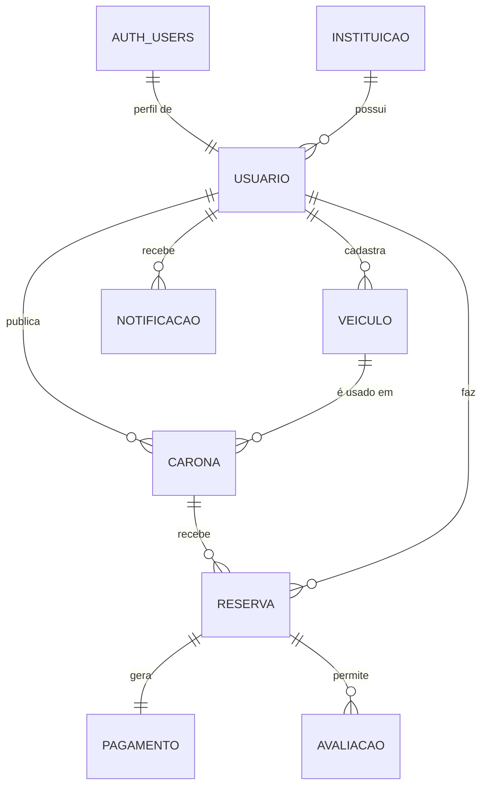

# DATABASE.md — Modelo de dados

> Fonte: DER da Aula 08. **Qualquer mudança aqui exige atualizar o DER e criar migration pelo Supabase CLI.**
> Banco: PostgreSQL (Supabase). Acesso: supabase-js (app) e funções SQL / Edge Functions (backend). Colunas em `snake_case`.

## Diagrama ER

`AUTH_USERS` é a tabela `auth.users`, gerenciada pelo Supabase Auth (e-mail, hash da senha, confirmação). O projeto não altera o schema `auth`.

## Dicionário de dados

Tipos para as migrations SQL. `PK` = chave primária, `FK` = chave estrangeira.

### INSTITUICAO
| Coluna | Tipo | Regras |
|---|---|---|
| id_instituicao | INT | PK, `generated always as identity` |
| nome | VARCHAR(120) | obrigatório |
| dominio_email | VARCHAR(80) | obrigatório, UNIQUE, sem `@` (ex.: `rede.ulbra.br`) |

### USUARIO (perfil — 1:1 com `auth.users`)
| Coluna | Tipo | Regras |
|---|---|---|
| id_usuario | UUID | PK, FK → `auth.users(id)` `on delete cascade` |
| id_instituicao | INT | FK → INSTITUICAO |
| nome_completo | VARCHAR(120) | obrigatório |
| email_institucional | VARCHAR(160) | obrigatório, UNIQUE, minúsculo (cópia de `auth.users.email`) |
| genero | ENUM `FEMININO`, `MASCULINO`, `OUTRO`, `NAO_INFORMADO` | usado no filtro US05 |
| telefone | VARCHAR(20) | opcional |
| expo_push_token | VARCHAR(100) | opcional; registrado pelo app (T29) |
| criado_em | TIMESTAMPTZ | default `now()` |

Criada pelo trigger `criar_perfil_usuario` (AFTER INSERT em `auth.users`), a partir de `raw_user_meta_data`: `id_instituicao` pelo domínio do e-mail, `email_institucional` em minúsculas, `nome_completo` (ausente → parte antes do `@`), `genero` (ausente ou fora do enum → `NAO_INFORMADO`) e `telefone` (em branco → nulo). Usuário cujo domínio não está em INSTITUICAO é recusado também pelo trigger (`DOMINIO_INVALIDO`), cobrindo contas criadas fora do cadastro (painel, Admin API). Senha e confirmação de e-mail ficam em `auth.users` (`encrypted_password`, `email_confirmed_at`).

### VEICULO
| Coluna | Tipo | Regras |
|---|---|---|
| id_veiculo | UUID | PK, default `gen_random_uuid()` |
| id_motorista | UUID | FK → USUARIO, default `auth.uid()` |
| modelo | VARCHAR(60) | obrigatório |
| placa | VARCHAR(8) | obrigatório, UNIQUE, CHECK formato antigo (`ABC1234`) ou Mercosul (`ABC1D23`), maiúsculas e sem hífen |
| cor | VARCHAR(30) | obrigatório |
| qtd_lugares | SMALLINT | CHECK 2 a 8 |
| motorizacao | VARCHAR(10) | ex.: `1.0`, `1.6` — só sugere o consumo inicial |
| consumo_kml | DECIMAL(4,1) | CHECK > 0; alimenta a sugestão de preço |

Exclusão: o trigger `impedir_exclusao_veiculo_em_uso` (BEFORE DELETE) recusa veículo com carona `ABERTA`/`LOTADA` (`VEICULO_EM_USO`) ou só com caronas `CONCLUIDA`/`CANCELADA` (`VEICULO_COM_HISTORICO`), ambos `PT409`. A FK `carona → veiculo` (NO ACTION) já impediria a exclusão com o erro técnico `23503`; o trigger troca esse erro por um código do domínio. Na exclusão da conta (`auth.users` → `usuario` → `veiculo` em cascata) o trigger não recusa: o perfil já foi removido e as caronas saem na mesma cascata.

### CARONA
| Coluna | Tipo | Regras |
|---|---|---|
| id_carona | UUID | PK |
| id_motorista | UUID | FK → USUARIO |
| id_veiculo | UUID | FK → VEICULO (do mesmo motorista) |
| origem | VARCHAR(200) | endereço legível |
| origem_lat / origem_lng | DECIMAL(9,6) | busca por proximidade |
| destino | VARCHAR(200) | endereço legível |
| destino_lat / destino_lng | DECIMAL(9,6) | |
| distancia_km | DECIMAL(6,2) | nulo até a Sprint 3 |
| data_hora_partida | TIMESTAMPTZ | no futuro na criação |
| vagas_ofertadas | SMALLINT | obrigatório, CHECK 1 a 7; fixado na publicação (`n_ocupantes = vagas_ofertadas + 1`, RN11) |
| vagas_disponiveis | SMALLINT | CHECK 0 a 7 e ≤ `vagas_ofertadas`; ≤ `qtd_lugares − 1` na criação; diminui a cada reserva |
| custo_estimado | DECIMAL(10,2) | nulo até a Sprint 3; teto do preço |
| custo_total | DECIMAL(10,2) | CHECK > 0; ≤ `custo_estimado` quando houver |
| tolerancia_min | SMALLINT | CHECK 0 a 30 |
| somente_mulheres | BOOLEAN | default `false` |
| status | ENUM `ABERTA`, `LOTADA`, `CANCELADA`, `CONCLUIDA` | default `ABERTA` |

### RESERVA (associativa USUARIO N:N CARONA)
| Coluna | Tipo | Regras |
|---|---|---|
| id_reserva | UUID | PK, default `gen_random_uuid()` |
| id_carona | UUID | FK → CARONA, `on delete cascade` |
| id_passageiro | UUID | FK → USUARIO, `on delete cascade` |
| valor_individual | DECIMAL(10,2) | obrigatório, CHECK > 0; rateio calculado na função `reservar_vaga` |
| status | ENUM `PENDENTE`, `CONFIRMADA`, `CANCELADA`, `EXPIRADA` | default `PENDENTE` |
| criado_em | TIMESTAMPTZ | default `now()`; base para expiração |

Índice único parcial `reserva_id_carona_id_passageiro_ativa_key`: (`id_carona`, `id_passageiro`) onde status em (`PENDENTE`, `CONFIRMADA`) — impede reserva dupla (RN14) e permite reservar de novo depois de `CANCELADA`/`EXPIRADA`. Índices em `id_carona` e `id_passageiro` (RLS e consultas por carona).

Índice parcial `reserva_pendente_criado_em_idx`: (`criado_em`) onde status = `PENDENTE` — varredura do job de expiração (T24).

### PAGAMENTO (1:1 com RESERVA)
| Coluna | Tipo | Regras |
|---|---|---|
| id_pagamento | UUID | PK, default `gen_random_uuid()` |
| id_reserva | UUID | FK → RESERVA, UNIQUE, `on delete cascade` |
| id_externo | VARCHAR(64) | UNIQUE; id da cobrança no Mercado Pago (idempotência); nulo até a cobrança existir |
| valor | DECIMAL(10,2) | obrigatório, CHECK > 0; = `valor_individual` |
| taxa_plataforma | DECIMAL(10,2) | obrigatório, CHECK ≥ 0 e ≤ `valor`; `valor × percentual_taxa` |
| valor_repassado | DECIMAL(10,2) | obrigatório, CHECK = `valor − taxa_plataforma` |
| metodo | ENUM `PIX` | default `PIX` |
| status | ENUM `PENDENTE`, `APROVADO`, `RECUSADO`, `REEMBOLSO_PENDENTE` | default `PENDENTE` |
| pago_em | TIMESTAMPTZ | preenchido pelo webhook; CHECK: obrigatório quando `status = APROVADO` |

### AVALIACAO
| Coluna | Tipo | Regras |
|---|---|---|
| id_avaliacao | UUID | PK |
| id_reserva | UUID | FK → RESERVA |
| id_avaliador | UUID | FK → USUARIO |
| id_avaliado | UUID | FK → USUARIO |
| nota | SMALLINT | CHECK 1 a 5 |
| comentario | VARCHAR(500) | opcional |
| criado_em | TIMESTAMPTZ | default `now()` |

UNIQUE (`id_reserva`, `id_avaliador`) (RN19); CHECK `id_avaliador <> id_avaliado`. FKs em cascata (a exclusão da conta leva as reservas e as avaliações junto). Índices em `id_avaliador` (RLS) e `id_avaliado` (média do perfil público). Criada na T30 (migration `concluir_avaliar`).

### NOTIFICACAO
| Coluna | Tipo | Regras |
|---|---|---|
| id_notificacao | UUID | PK |
| id_usuario | UUID | FK → USUARIO |
| tipo | ENUM `NOVA_RESERVA`, `RESERVA_CONFIRMADA`, `CARONA_CANCELADA`, `RESERVA_CANCELADA`, `AVALIACAO` | |
| mensagem | VARCHAR(300) | |
| lida | BOOLEAN | default `false` |
| criado_em | TIMESTAMPTZ | default `now()` |

### PARAMETRO_CUSTO
| Coluna | Tipo | Regras |
|---|---|---|
| id_parametro | INT | PK, `generated always as identity` |
| preco_litro | DECIMAL(5,2) | obrigatório, CHECK > 0; mantido pela equipe |
| percentual_taxa | DECIMAL(5,4) | obrigatório, CHECK 0 a 1; ex.: `0.0500` = 5% |
| atualizado_em | TIMESTAMPTZ | default `now()` |

O registro mais recente (`atualizado_em`) é o vigente. Valor inicial na migration `reserva_pagamento`, idempotente (só insere com a tabela vazia): `preco_litro = 6.29`, `percentual_taxa = 0.1000` (10%). Sem acesso pelo app (RLS sem políticas, sem grant para `authenticated`).

## Cardinalidades

| Relacionamento | Card. | Leitura |
|---|---|---|
| auth.users — USUARIO | 1:1 | Cada conta do Auth tem um perfil |
| INSTITUICAO — USUARIO | 1:N | Uma instituição possui vários alunos |
| USUARIO — VEICULO | 1:N | Um motorista cadastra vários veículos |
| USUARIO — CARONA | 1:N | Um motorista publica várias caronas |
| VEICULO — CARONA | 1:N | Um veículo é usado em várias caronas |
| CARONA — RESERVA | 1:N | Uma carona recebe várias reservas |
| USUARIO — RESERVA | 1:N | Um passageiro faz várias reservas |
| USUARIO — CARONA (via RESERVA) | N:N | Resolvido pela associativa RESERVA |
| RESERVA — PAGAMENTO | 1:1 | Cada reserva gera um pagamento |
| RESERVA — AVALIACAO | 1:N | Avaliação mútua entre participantes |
| USUARIO — NOTIFICACAO | 1:N | Um usuário recebe várias notificações |

## Row Level Security (resumo)

RLS habilitada em **todas** as tabelas. Escrita em tabelas com regra de negócio só por funções SQL (`SECURITY DEFINER`).

| Tabela | SELECT | INSERT / UPDATE / DELETE pelo app |
|---|---|---|
| instituicao | todos os autenticados | — |
| usuario | só a própria linha (`id_usuario = auth.uid()`) | UPDATE da própria linha (colunas liberadas por `grant update (...)`) |
| veiculo | só os próprios | todos, só nos próprios |
| carona | motorista vê as próprias; busca/detalhe via funções | — (funções `publicar_carona`, `cancelar_carona`, `concluir_carona`) |
| reserva | passageiro vê as próprias; motorista vê as das suas caronas | — (Edge Function `reservar-vaga`, função `cancelar_reserva`) |
| pagamento | passageiro da reserva (o motorista não vê) | — (Edge Functions) |
| avaliacao | só o avaliador lê as próprias (o que recebeu aparece só agregado no `perfil_publico`) | — (função `avaliar_participante`) |
| notificacao | só as próprias | UPDATE da coluna `lida` nas próprias |
| parametro_custo | — | — |

View `perfil_publico` (`security_invoker = false`, só colunas públicas): nome e média de avaliações.

Leitura de caronas de outros motoristas: só pelas RPCs `buscar_caronas` e `detalhar_carona` (`SECURITY DEFINER`, colunas públicas), sem política nova em `carona`, `usuario` ou `veiculo`. Isso também evita recursão de RLS: a política do motorista em `reserva` consulta `carona`, e uma política de `carona` que consultasse `reserva` entraria em loop (T18).

## Funções, triggers e jobs

| Objeto | Tipo | Papel |
|---|---|---|
| `validar_dominio_institucional` | Auth Hook (Before User Created), `SECURITY DEFINER`, `EXECUTE` só para `supabase_auth_admin` | RN01: domínio exato após o `@`, em minúsculas; recusa com 422 `DOMINIO_INVALIDO` |
| `criar_perfil_usuario` | Trigger AFTER INSERT em `auth.users`, `SECURITY DEFINER` | Cria a linha de USUARIO |
| `impedir_exclusao_veiculo_em_uso` | Trigger BEFORE DELETE em `veiculo`, `SECURITY DEFINER`, sem `EXECUTE` para nenhum papel | Recusa excluir veículo com carona (`VEICULO_EM_USO` / `VEICULO_COM_HISTORICO`, `PT409`) |
| `publicar_carona` | Função RPC, `SECURITY DEFINER`, `EXECUTE` só para `authenticated` | Cria a carona `ABERTA` do `auth.uid()` (RN04–RN06, US03, US07), com `vagas_ofertadas = vagas_disponiveis` (RN11); entrada inválida vira `PTxxx` com hint |
| `buscar_caronas` | Função RPC, `STABLE`, `SECURITY DEFINER`, `EXECUTE` só para `authenticated` | US05, RN08: caronas `ABERTA`, com vaga e futuras por proximidade da origem (bounding box + haversine) e horário; sem as próprias (RN14) e com `somente_mulheres` só para usuárias (RN18); só colunas públicas; desde a T43 (migration `nota_motorista_busca`, `drop` + `create`), também `media_motorista` (1 casa, nula sem avaliações) e `total_avaliacoes_motorista` no fim, pela `resumo_avaliacoes` |
| `detalhar_carona` | Função RPC, `STABLE`, `SECURITY DEFINER`, `EXECUTE` só para `authenticated` | Uma carona com veículo e placa, visível ao motorista, a quem tem reserva e, se `ABERTA` e futura, aos demais; senão `CARONA_NAO_ENCONTRADA` |
| `valor_por_passageiro` | Função SQL `IMMUTABLE`, sem `EXECUTE` para o app | Fórmula única do rateio (RN11): `round(custo_total ÷ (vagas_ofertadas + 1), 2)`; usada na busca, no detalhe e na reserva (T21) |
| `cancelar_carona(p_id_carona)` → `integer` | Função RPC `SECURITY DEFINER`, `EXECUTE` só para `authenticated` (T28) | RN07: o motorista do `auth.uid()` cancela a própria carona `ABERTA`/`LOTADA` antes da partida. Com a carona travada e depois as reservas ativas e os pagamentos delas (ordem de locks das outras funções), carona `CANCELADA`, cada reserva `PENDENTE`/`CONFIRMADA` → `CANCELADA`, pagamento `PENDENTE` → `RECUSADO` e `APROVADO` → `REEMBOLSO_PENDENTE`. Não mexe em `vagas_disponiveis`. Devolve quantas reservas cancelou. Erros: `CARONA_NAO_ENCONTRADA` (PT404, inexistente ou de outro motorista), `CANCELAMENTO_ENCERRADO` (PT409) |
| `prazo_conclusao_carona()`, `prazo_avaliacao()` | Funções SQL `IMMUTABLE`, só `service_role` (T30) | Únicos lugares dos prazos: `interval '1 day'` (RN07) e `interval '7 days'` (RN19) |
| `concluir_carona(p_id_carona)` → `integer` | Função RPC `SECURITY DEFINER`, `EXECUTE` só para `authenticated` (T30) | RN07: o motorista do `auth.uid()` conclui a própria carona `ABERTA`/`LOTADA` entre a partida e `partida + prazo_conclusao_carona()`, com a carona travada (`FOR UPDATE`). Só muda o status (reservas e pagamentos ficam como estão). Devolve quantas reservas `CONFIRMADA` a carona tinha. Erros: `CARONA_NAO_ENCONTRADA` (PT404), `CARONA_JA_ENCERRADA`, `CARONA_NAO_PARTIU`, `CONCLUSAO_ENCERRADA` (PT409) |
| `concluir_caronas_vencidas()` → `integer` | Função `SECURITY DEFINER`, sem `EXECUTE` para `public`/`anon`/`authenticated`; executam o job e a `service_role` (T30) | RN07: um `UPDATE` só, que trava cada carona `ABERTA`/`LOTADA` com `partida + prazo_conclusao_carona() < now()` e a marca `CONCLUIDA` (a condição é reavaliada depois do lock). Devolve quantas concluiu |
| `reservar_vaga` | Função `SECURITY DEFINER`, `EXECUTE` só para `service_role` (Edge Function `reservar-vaga`) | Transação única com `SELECT carona FOR UPDATE`: valida RN08, RN14 e RN18, grava reserva `PENDENTE` (rateio por `valor_por_passageiro`, RN11) e pagamento `PENDENTE` com taxa e repasse (RN13), baixa a vaga e marca `LOTADA` com 0 vagas (RN07, RN17) |
| `minhas_reservas()` | Função RPC, `STABLE`, `SECURITY DEFINER`, `EXECUTE` só para `authenticated` (T25) | Reservas do `auth.uid()`, mais recentes primeiro, com o status e o valor do pagamento e as colunas públicas da carona (origem, destino, partida, status) e o primeiro nome do motorista; desde a T42 (migration `nota_motorista_reservas`, `drop` + `create`), também `media_motorista` (1 casa, nula sem avaliações) e `total_avaliacoes_motorista`, pela `resumo_avaliacoes`. Existe porque o passageiro não lê a tabela `carona` (mesmo padrão da `detalhar_carona`) |
| `prazo_cancelamento_confirmada()` | Função SQL `IMMUTABLE`, só `service_role` (T28) | Único lugar do prazo da RN20: `interval '2 hours'` |
| `cancelar_reserva(p_id_reserva)` → `text` | Função RPC `SECURITY DEFINER`, `EXECUTE` só para `authenticated` (T28) | RN20, RN17: o passageiro do `auth.uid()` cancela a própria reserva. Trava a carona, depois a reserva (conferida de novo) e o pagamento. `PENDENTE` até a partida (pagamento `RECUSADO`); `CONFIRMADA` até `prazo_cancelamento_confirmada()` antes da partida (pagamento `APROVADO` → `REEMBOLSO_PENDENTE`). Nos dois casos devolve a vaga e `LOTADA` volta a `ABERTA`; devolve `CANCELADA`. Erros: `RESERVA_NAO_ENCONTRADA` (PT404, inexistente ou de outro usuário), `RESERVA_JA_ENCERRADA`, `CANCELAMENTO_ENCERRADO`, `PRAZO_CANCELAMENTO_ENCERRADO` (PT409) |
| `prazo_reserva_pendente()` | Função SQL `IMMUTABLE`, só `service_role` (T24) | Único lugar do prazo da RN16: `interval '15 minutes'` |
| `expirar_reservas()` | Função `SECURITY DEFINER`, sem `EXECUTE` para `public`/`anon`/`authenticated`; executam o dono (job do pg_cron) e a `service_role` (T24) | RN16, RN17: para cada reserva `PENDENTE` com `criado_em` mais antigo que o prazo, trava a carona, depois a reserva e o pagamento (mesma ordem de locks da `reservar_vaga`, da `desfazer_reserva_sem_cobranca` e da `confirmar_pagamento`), confere de novo (ainda `PENDENTE` e vencida; se o webhook confirmou no meio-tempo, pula), marca a reserva `EXPIRADA` e o pagamento `PENDENTE` como `RECUSADO`, devolve a vaga e volta a carona `LOTADA` para `ABERTA` (`CANCELADA` e `CONCLUIDA` não mudam). Devolve quantas expirou. Um Pix pago depois disso vira `REEMBOLSO_PENDENTE` na `confirmar_pagamento`, sem mexer na vaga |
| `registrar_cobranca(p_id_pagamento, p_id_externo)` | Função `SECURITY DEFINER`, só `service_role` (T22) | Grava o id da order do Mercado Pago no pagamento `PENDENTE` criado por `reservar_vaga`; idempotente com o mesmo id; recusa id diferente (`COBRANCA_DIVERGENTE`), order de outro pagamento (`COBRANCA_DUPLICADA`) e pagamento que não está mais pendente (`PAGAMENTO_ENCERRADO`) |
| `desfazer_reserva_sem_cobranca(p_id_reserva)` | Função `SECURITY DEFINER`, só `service_role` (T22) | Cobrança Pix falhou: com a carona travada (`FOR UPDATE`, mesma ordem de locks da `reservar_vaga`), reserva `CANCELADA`, pagamento `RECUSADO`, vaga devolvida e `LOTADA` volta a `ABERTA`. Só age em reserva `PENDENTE` com pagamento sem `id_externo`; devolve `true` se agiu |
| `confirmar_pagamento(p_id_externo, p_id_pagamento, p_valor)` | Função `SECURITY DEFINER`, só `service_role` (webhook, T23) | Order paga consultada na API: confere order e valor; com a carona, a reserva e o pagamento travados (mesma ordem de locks da `reservar_vaga`), pagamento `APROVADO` (`pago_em`) e reserva `CONFIRMADA` → `CONFIRMADO`; repetição → `JA_CONFIRMADO` (idempotente); reserva `CANCELADA`/`EXPIRADA` → pagamento `REEMBOLSO_PENDENTE` sem confirmar e sem mexer na vaga; `id_externo` nulo é aceito pelo `external_reference` e gravado. Não altera vagas |
| `resumo_avaliacoes(p_id_usuario)` | Função SQL `STABLE`, interna (sem `EXECUTE` para o app) (T30) | Média com 1 casa (`round(avg(nota), 1)`, nula sem avaliações) e total das avaliações recebidas; usada pelo `perfil_publico` e pelo `detalhar_carona` |
| `avaliar_participante(p_id_reserva, p_nota, p_comentario = null)` → `uuid` | Função RPC `SECURITY DEFINER`, `EXECUTE` só para `authenticated` (T30) | RN19: o avaliado é deduzido (passageiro → motorista; motorista → passageiro). Reserva `CONFIRMADA`, carona `CONCLUIDA`, até `partida + prazo_avaliacao()`; nota 1 a 5; comentário aparado, vazio vira nulo, até 500. Locks: carona e reserva `FOR SHARE`. Erros: `NOTA_INVALIDA` (PT422), `DADOS_INVALIDOS` (PT400), `RESERVA_NAO_ENCONTRADA` (PT404, inexistente ou de quem não participa), `AVALIACAO_INDISPONIVEL`, `PRAZO_AVALIACAO_ENCERRADO`, `AVALIACAO_DUPLICADA` (PT409) |
| `avaliacoes_pendentes()` | Função RPC `STABLE`, `SECURITY DEFINER`, `EXECUTE` só para `authenticated` (T30) | As reservas que o `auth.uid()` ainda pode avaliar: `id_reserva`, `papel` (`PASSAGEIRO`/`MOTORISTA`, de quem avalia), `nome_avaliado` (primeiro nome), `origem`, `destino`, `data_hora_partida`, `avaliar_ate` |
| `perfil_publico(p_id_usuario)` | Função RPC `STABLE`, `SECURITY DEFINER`, `EXECUTE` só para `authenticated` (T30) | `id_usuario`, `nome`, `media_avaliacoes` (1 casa), `total_avaliacoes`; sem e-mail, telefone nem gênero. Função e não view `security definer` (o linter do Supabase marca essas views). Inexistente → `USUARIO_NAO_ENCONTRADO` (PT404) |
| `detalhar_carona` (versão T30) | Mesma função, nova versão na migration `concluir_avaliar` | Passa a devolver `media_motorista` e `total_avaliacoes_motorista` (de `resumo_avaliacoes`) |
| Triggers de notificação | Triggers em `reserva`/`carona` | Gravam NOTIFICACAO |
| `expirar-reservas` | Job pg_cron (`* * * * *`, T24) | RN16: `select public.expirar_reservas()`. Extensão `pg_cron` em `pg_catalog` (jeito indicado pelo Supabase Cron); `cron.schedule` com o mesmo nome substitui o job (upsert), então reagendar não duplica. O job roda como `postgres`, dono da função |
| `concluir-caronas` | Job pg_cron (`0 * * * *`, T30) | RN07: `select public.concluir_caronas_vencidas()`, agendado com `cron.schedule` pelo nome (reagendar não duplica) |
| Webhook `notificacao` INSERT | Database Webhook | Chama a Edge Function `enviar-push` |

## Alterações propostas em relação ao DER da Aula 08

Aprovadas em 02/10/2026 (decorrem do ADR-009; aplicadas na migration `schema_inicial`, T06):

- `USUARIO.id_usuario` passa a ser FK para `auth.users(id)`; **saem** `senha_hash` e `email_verificado` (ficam no Supabase Auth — ADR-009).
- `USUARIO.expo_push_token` (VARCHAR, opcional): necessário para enviar push (T29).

Aprovadas em 16/10/2026 (Gustavo, no merge da T20; aplicadas na migration `reserva_pagamento`):

- `RESERVA.status`: incluir `CANCELADA` e `EXPIRADA`.
- `PAGAMENTO.status`: valores `PENDENTE`, `APROVADO`, `RECUSADO`, `REEMBOLSO_PENDENTE`.
- `PAGAMENTO.id_externo` (VARCHAR, UNIQUE): id da cobrança no Mercado Pago, usado para idempotência do webhook.
- `CARONA.vagas_ofertadas` (SMALLINT, obrigatório): vagas oferecidas na publicação, base do rateio (RN11).

O DER da Aula 08 ainda precisa ser redesenhado com todas as alterações acima.

## Migrations

- Criar sempre com `supabase migration new <descricao>` (ex.: `init`, `rls_base`, `reserva_pagamento`) e escrever o SQL no arquivo gerado.
- Toda migration que cria tabela também habilita RLS e cria as políticas no mesmo arquivo.
- Privilégios padrão (migration `privilegios_padrao`): objeto novo nasce sem acesso para `anon`/`authenticated`; a migration concede explicitamente o mínimo (`grant select ...`, `grant execute ...`).
- Testar com `supabase db reset` (local) antes do PR; aplicar no projeto remoto com `supabase db push` (via deploy da `main`).
- Nunca editar migration já aplicada na `develop`; criar uma nova. Nunca alterar o schema pelo painel do projeto remoto.
- **Dados essenciais** (INSTITUICAO ULBRA e PARAMETRO_CUSTO inicial) vão em migration idempotente (`insert ... on conflict do nothing`), porque `seed.sql` só roda localmente.
- `supabase/seed.sql`: dados de desenvolvimento (usuários, veículos e caronas de teste).

## Performance

- Índices: `carona(status, data_hora_partida)`, `carona(origem_lat, origem_lng)`, `reserva(id_carona)`, `reserva(id_passageiro)`, `notificacao(id_usuario, lida)`.
- Colunas usadas nas políticas RLS (`id_motorista`, `id_passageiro`, `id_usuario`) indexadas; nas políticas, usar `(select auth.uid())` para o Postgres avaliar uma vez por consulta.
- Busca por proximidade no MVP: dentro de `buscar_caronas`, filtro por bounding box (lat/lng ± delta) + distância haversine em SQL. PostGIS fica para depois, se necessário.
